# Manifest

## single-tet.h5m/exo

A mesh containing a single tetrahedron. In the case of the `.h5m` file, the tet
composes a single volume and each triangle of the tet is it's own surface.

| Element Type      | Count |
|-------------------|-------|
| Surface Triangles | 4     |
| Tetrahedrons      | 1     |

  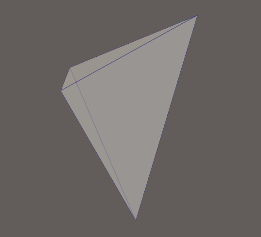

The same mesh as above but uniformly refined one time to form a small tet mesh consisting of 8 tetrahedra with the same external nodes mesh containing a single tetrahedron.

| Element Type      | Count |
|-------------------|-------|
| Surface Triangles | 16    |
| Tetrahedrons      | 8     |

  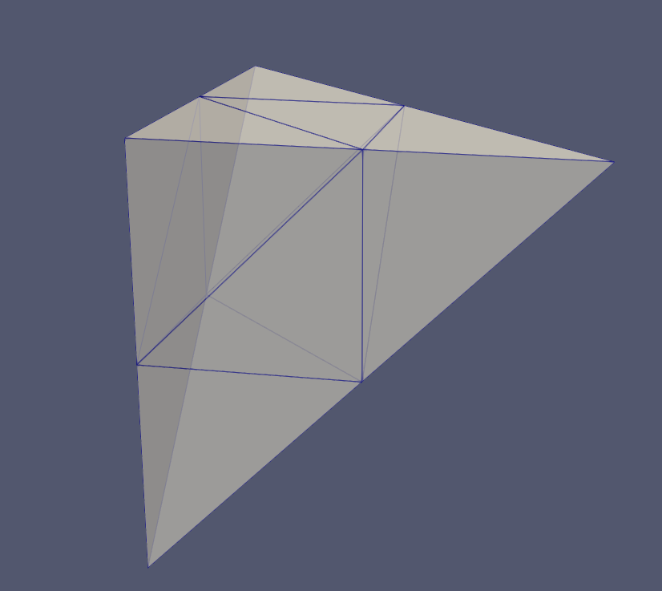

## jezebel.h5m

A simple sphere geometry matching the size of the Jezebel bare sphere core (more info [here](https://www.osti.gov/servlets/purl/1344338)). This file contains a surface mesh only.

| Element Type      | Count |
|-------------------|-------|
| Surface Triangles | 1276  |
| Tetrahedrons      | 10333 |

## jezebel.exo

A simple sphere geometry matching the size of the Jezebel bare sphere core (more info [here](https://www.osti.gov/servlets/purl/1344338)).
This file contains a tetrahedral mesh.

| Element Type      | Count |
|-------------------|-------|
| Surface Triangles | 1276  |
| Tetrahedrons      | 10333 |

## no_overlap.h5m
A simple cube and Cylinder geometry with two volumes that do no overlap.

| Element Type      | Count |
|-------------------|-------|
| Surface Triangles | 1032  |

## no_overlap_imp.h5m
The same as no_overlap.h5m but imprinted?

| Element Type      | Count |
|-------------------|-------|
| Surface Triangles | 1290  |

## overlap.h5m
A simple Cube and Sphere geometry with two volumes that do overlap.

| Element Type      | Count |
|-------------------|-------|
| Surface Triangles | 88220 |

## small_overlap.h5m
A simple Cube and Cylinder geometry with two volumes that overlap over a very small region.

| Element Type      | Count |
|-------------------|-------|
| Surface Triangles | 1032  |

## enclosed.h5m
A simple geometry with two concentric Cylinders - one completely enclosed by the larger one.

| Element Type      | Count |
|-------------------|-------|
| Surface Triangles | 2040  |

## brick.exo
A 10 x 10 x 10 brick centered on the origin. No additional sidesets. (tet mesh)

| Element Type      | Count |
|-------------------|-------|
| Surface Triangles | 1404  |
| Tetrahedrons      | 8790  |

## brick-sidesets.exo
A 10 x 10 x 10 brick centered on the origin. Each surface has a sideset. (tet mesh)

| Element Type      | Count |
|-------------------|-------|
| Surface Triangles | 1404  |
| Tetrahedrons      | 8790  |

## cyl-brick.exo
A 10 x 10 x 10 brick centered on (0, 0, 10) and a cylinder of radius 5 height 10 centered on the origin w/ rotation axis along Z. (tet mesh)

| Element Type      | Count |
|-------------------|-------|
| Surface Triangles | 2692  |
| Tetrahedrons      | 8790  |

## overlap-edge.h5m
A simple edge overlap case consisting of two identical pyramids which have a volume overlap along a triangle edge (no overlapping vertices).

| Element Type      | Count |
|-------------------|-------|
| Surface Triangles | 44    |

  

## beam-overlaps.h5m
A second edge overlap case consisting of two identical beams (cuboids) which have a larger volume overlap (no vertices) along multiple edges.

| Element Type      | Count |
|-------------------|-------|
| Surface Triangles | 136   |

  

# pincell.h5m and pincell-implicit.exo

These two files contain identical meshing in MOAB (`.h5m`) and libMesh (`.exo`)
formats. Metadata is applied in the Cubit model (found in `pincell-both.cub5`)
for both formats as well.

## pincell.h5m

| Element Type      | Count |
|-------------------|-------|
| Surface Triangles | 32544 |

## pincell.exo

| Element Type      | Count |
|-------------------|-------|
| Surface Triangles | 24912 |
| Tetrahedrons      | 93170 |

  
  

In the case of the libMesh model, boundary conditions are only applied to the
outer volume. The interior interfaces of the model are discovered automatically
as implicit boundaries based on the transition between mesh blocks.

# segmented-beam.h5m

A simple rectangular beam segmented into 20 seperate volumes along the x-axis.

| Element Type      | Count |
|-------------------|-------|
| Surface Triangles | 1106  |

  

# cube-mesh-no-geom.exo/h5m/cub5

A simple cube geometry that holds no metadata, only a tet mesh.

  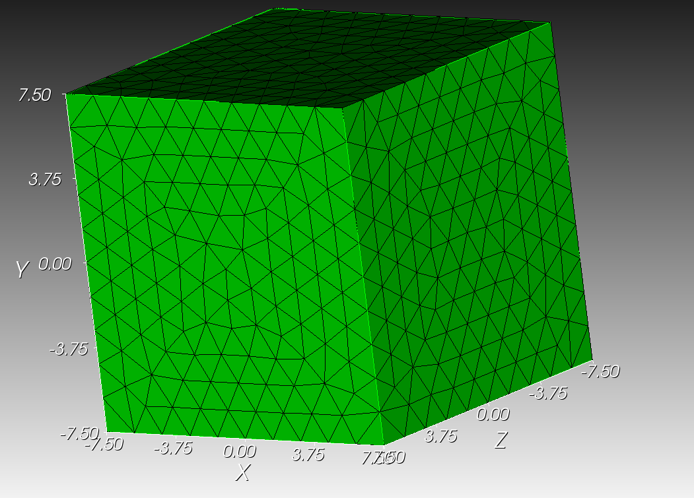

## Jezebel-quads

A simple sphere surface mesh composed of quadrilateral elements. This model
matches the dimensions of the tet/tri jezebel files above.

| Element Type   | Count |
|----------------|-------|
| Surface Quads  | 2400  |
| Hexahedra      | 36800 |

  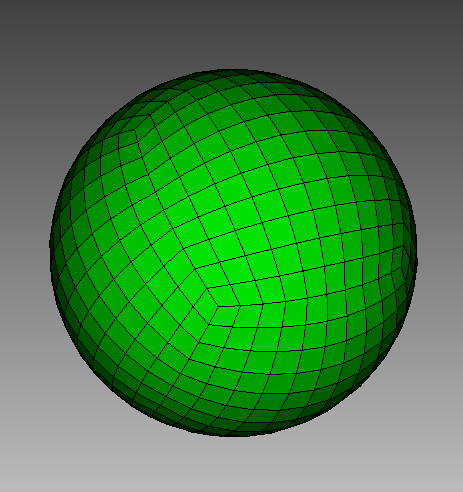

## cyl-brick-quads.h5m/exo

A 10 x 10 x 10 brick centered on (0, 0, 14.5) and a cylinder of radius 5 height 15 centered on the origin w/ rotation axis along Z. (hex mesh)

| Element Type   | Count  |
|----------------|--------|
| Surface Quads  | 30478  |
| Hexahedra      | 187200 |

  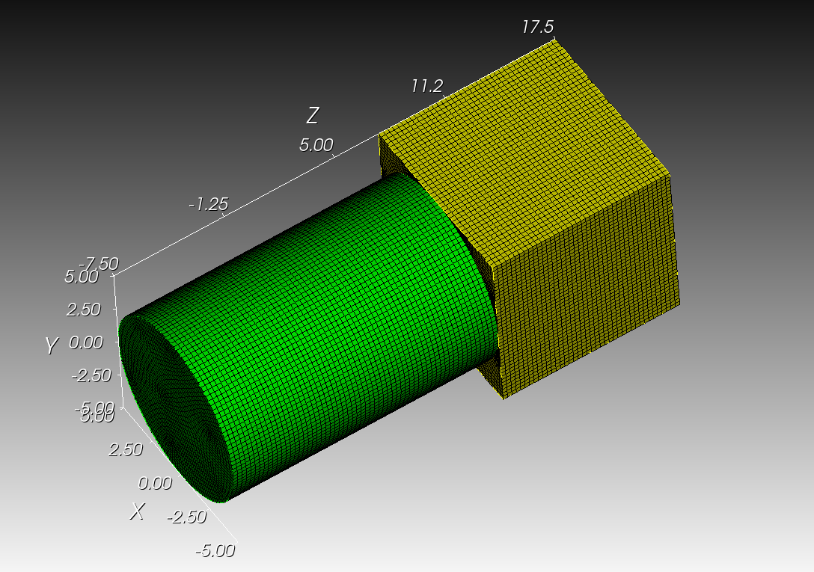

## Cube with Multiblock Sideset (cube-w-multiblock-sideset.*)

This test case is added to address https://github.com/xdg-org/xdg/issues/212
specifically. Cubit, MOAB, and Exodus file are provided.

| Element Type   | Count |
|----------------|-------|
| Triangles      | 3234  |
| Tetrahedron    | 13000 |
| Vertices       | 5204  |

  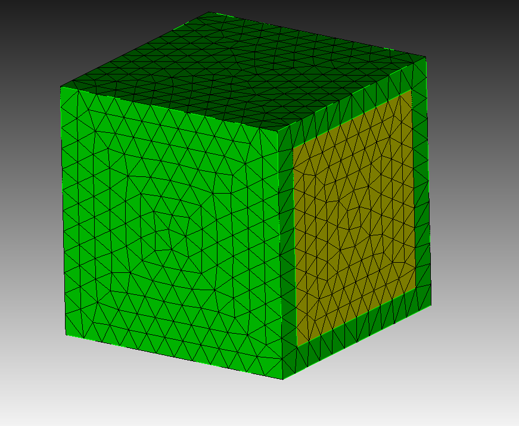
  

## cyl-brick-quads.h5m/exo

A 10 x 10 x 10 brick centered on (0, 0, 14.5) and a cylinder of radius 5 height 15 centered on the origin w/ rotation axis along Z. (hex mesh)

| Element Type   | Count  |
|----------------|--------|
| Surface Quads  | 30478  |
| Hexahedra      | 187200 |

  

## regularized_tet_mesh.exo/h5m

This is a tet mesh created with tets matching the boundary of a regular/Cartesian mesh 10 elements in each direction x, y, and z and extents from (-10, -10, -10) to (10, 10, 10) in model units. There are 12 tetrahedron per single regularized mesh element.

No geometry metadata is added to this mesh. It is used purely to test element-to-element ray traversal.

| Element Type  | Count |
|---------------|-------|
| Tetrahedron   | 12000 |

  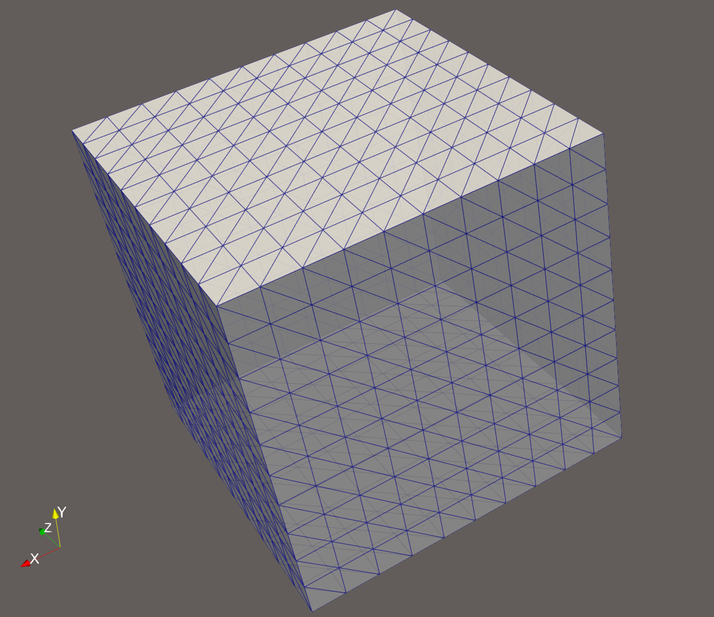

## regularized_hex_mesh.exo/h5m

This is a tet mesh created with tets matching the boundary of a regular/Cartesian mesh 10 elements in each direction x, y, and z and extents from (-10, -10, -10) to (10, 10, 10) in model units. There is one hexahedral element per regularized mesh element.

No geometry metadata is added to this mesh. It is used purely to test element-to-element ray traversal.

| Element Type  | Count |
|---------------|-------|
| Tetrahedron   | 1000  |

  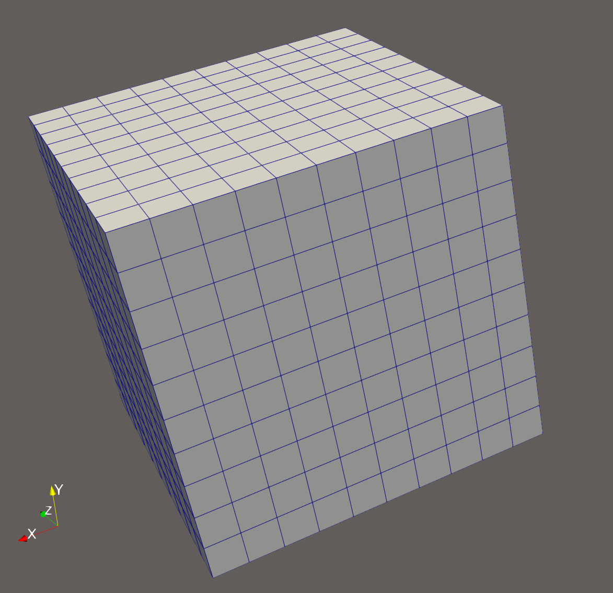

## four_region_hex.exo/h5m

This is a hex mesh of a four-region geometry segmented into two volumes. Region one extends from
(-0.5, -0.5, -0.25) to (0.5, 0.5, 0.25), region two extends from (-0.5, -0.5, 0.25) to (0.5, 0.5, 0.75),
region three extends from (-0.5, -0.5, 0.75) to (0.5, 0.5, 1.25), and region four extends from
(-0.5, -0.5, 1.25) to (0.5, 0.5, 1.75). Regions one and three are bundled into a single volume (with
an ID of 2), and regions two and four are bundled into a single volume (with an ID of 1). Each
region contains 64 hexahedral elements.

No geometry metadata is added to this mesh. It is used purely to test mesh manager volume inclusion/exclusion.

| Element Type  | Count |
|---------------|-------|
| Hexahedron    | 256   |

  

## amr_mesh_tet.exo

This is a tetrahedral mesh of a two region geometry with elements generated from an adaptive mesh refinement sequence
from within XDG's test suite. As AMR connectivity is not stored in Exodus files, the adapted mesh cannot be
loaded from a file (and so the unadapted mesh is included here).

No geometry metadata is added to this mesh. It is used purely to test element to element ray traversal and find
element calls when an AMR mesh is provided to a libMesh mesh manager.

| Element Type  | Count (no AMR) | Count (with AMR) |
|---------------|----------------|------------------|
| Tetrahedron   |       192      |       6352       |

  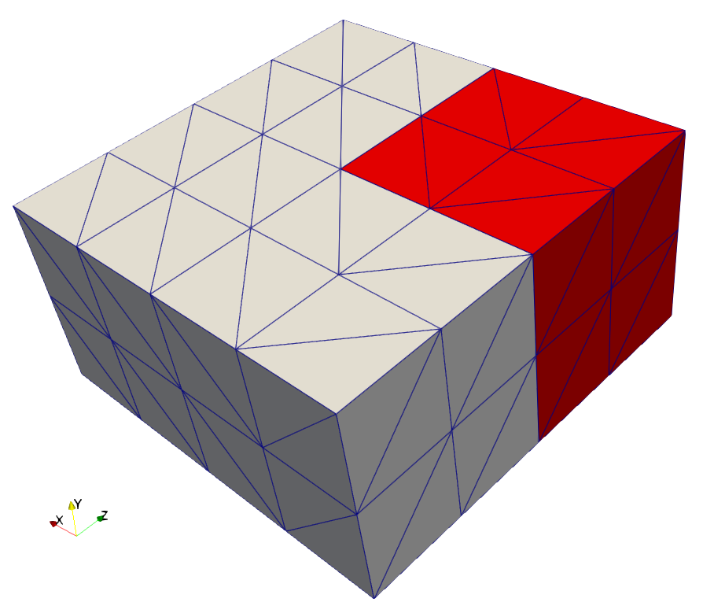
  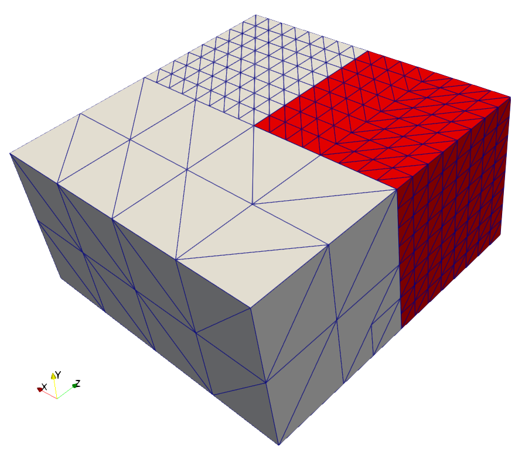

## amr_mesh_hex.exo

This is a hexahedral mesh of a two region geometry with elements generated from an adaptive mesh refinement sequence
from within XDG's test suite. As AMR connectivity is not stored in Exodus files, the adapted mesh cannot be
loaded from a file (and so the unadapted mesh is included here).

No geometry metadata is added to this mesh. It is used purely to test element to element ray traversal and find
element calls when an AMR mesh is provided to a libMesh mesh manager.

| Element Type  | Count (no AMR) | Count (with AMR) |
|---------------|----------------|------------------|
| Hexahedron    |       32       |       1096       |

  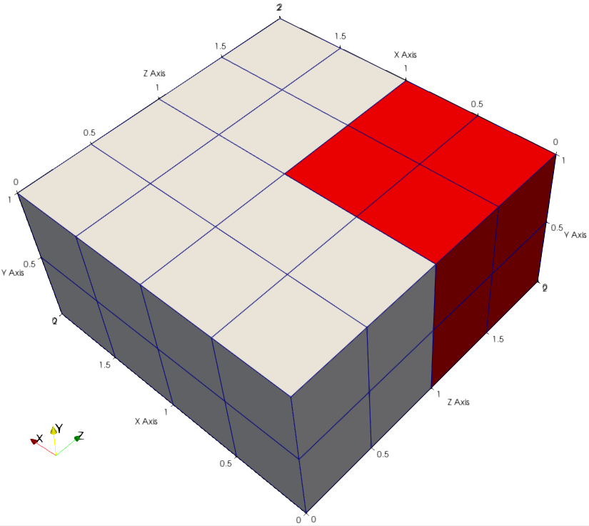
  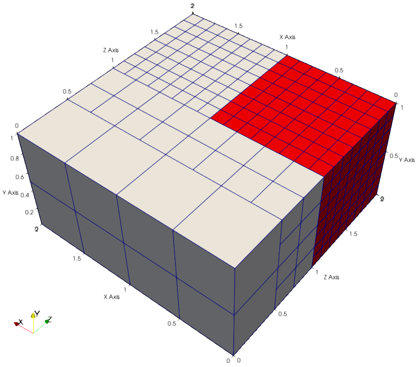

